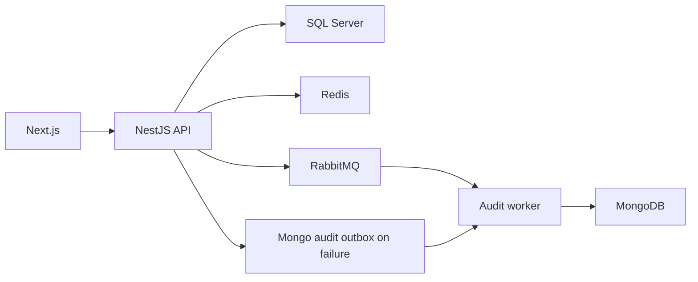

# Backend Architecture

Fleet management for brands, models, vehicles, users, sessions and audit. The frontend browses/manages records according to permissions. SQL Server stores relational domain data, MongoDB stores audit, while Redis/RabbitMQ provide caching, operational controls and messaging.

## Implemented behavior

NestJS 11, TypeScript 5.7, TypeORM 0.3, Mongoose 8, Redis, RabbitMQ and Cockatiel backend; Next.js 16.2.7/React 19.2.4, TanStack Query 5, Redux Toolkit and Zod frontend. Domain modules separate application, domain, infrastructure and interfaces. API and audit-worker have separate entry points. Ports/repositories, UnitOfWork and domain events structure the application; adapters/feature toggles determine actual behavior.

## Related files

- [backend/src/modules/fleet/application/vehicles.service.ts](https://github.com/Vidigal-code/fleetcore-api/blob/a0b587d48f6701f76facddd40828cd47c0c6fbb2/backend/src/modules/fleet/application/vehicles.service.ts)
- [backend/src/modules/auth/interfaces/http/auth.controller.ts](https://github.com/Vidigal-code/fleetcore-api/blob/a0b587d48f6701f76facddd40828cd47c0c6fbb2/backend/src/modules/auth/interfaces/http/auth.controller.ts)
- [backend/src/modules/audit/audit.service.ts](https://github.com/Vidigal-code/fleetcore-api/blob/a0b587d48f6701f76facddd40828cd47c0c6fbb2/backend/src/modules/audit/audit.service.ts)
- [backend/src/modules/audit/relays/audit-outbox-relay.service.ts](https://github.com/Vidigal-code/fleetcore-api/blob/a0b587d48f6701f76facddd40828cd47c0c6fbb2/backend/src/modules/audit/relays/audit-outbox-relay.service.ts)
- [backend/src/shared/features/feature-toggle.service.ts](https://github.com/Vidigal-code/fleetcore-api/blob/a0b587d48f6701f76facddd40828cd47c0c6fbb2/backend/src/shared/features/feature-toggle.service.ts)
- [docker-compose.yml](https://github.com/Vidigal-code/fleetcore-api/blob/a0b587d48f6701f76facddd40828cd47c0c6fbb2/docker-compose.yml)

## Navigation

- [Project guide](?menu=en&lang=en&id=18)
- [Source reference](?menu=en&lang=en&id=19)
