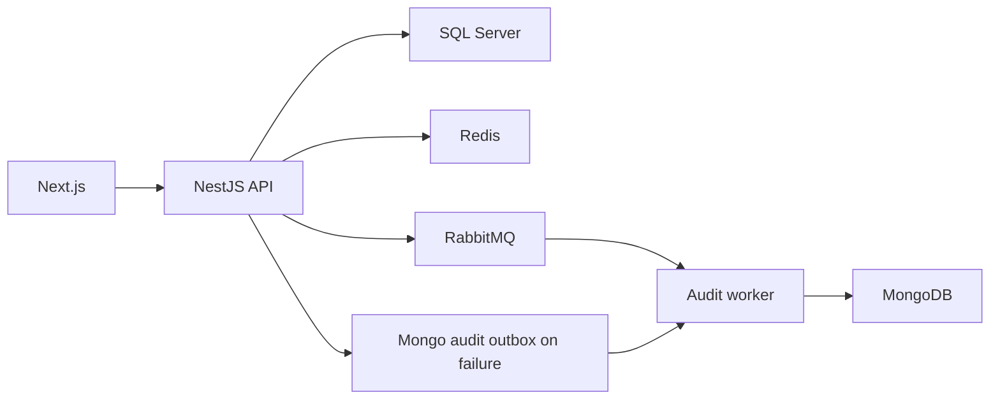

# fleetcore-api: Project context and workflows

GitPageDocs **0.0.26** · 1.0.0 · 2026-11-08

## Context

Fleet management for brands, models, vehicles, users, sessions and audit. The frontend browses/manages records according to permissions. SQL Server stores relational domain data, MongoDB stores audit, while Redis/RabbitMQ provide caching, operational controls and messaging.

## Stack and architecture

NestJS 11, TypeScript 5.7, TypeORM 0.3, Mongoose 8, Redis, RabbitMQ and Cockatiel backend; Next.js 16.2.7/React 19.2.4, TanStack Query 5, Redux Toolkit and Zod frontend. Domain modules separate application, domain, infrastructure and interfaces. API and audit-worker have separate entry points. Ports/repositories, UnitOfWork and domain events structure the application; adapters/feature toggles determine actual behavior.



## End-to-end workflows

1. /api/auth/register creates users; /api/auth/login validates credentials and issues a JWT with session context. /api/auth/me reads the profile; update/profile and update/password mutate it; logout invalidates sessionId. JWT signature is not the only validity check: the session is also verified. The source reference links endpoints and permission decorators.

2. Brand → associated model → vehicle. VehiclesService checks model existence and uniqueness before persistence and uppercases plates. The aggregate stores plate, chassis, renavam, year, modelId, actor and dates. Search filters plate/model/brand with pagination (page 1, limit 20 defaults). Detailed format rules reside in DTOs/value objects, not only the entity.

3. Reads use RepositoryCacheService when repositoryCache is enabled; writes use UnitOfWork and invalidate list/detail caches. They then record audit and publish domain events. SQL commit and external-system delivery are separate steps, not one transaction spanning SQL, Mongo and the broker.

4. AuditService publishes to the broker with auditAsyncWorker enabled. Publication failure queues a Mongo outbox entry; failure there falls back to direct persistence. With the toggle off it persists directly. The relay runs only in audit-worker, recovers abandoned PROCESSING entries and republishes batches with an attempt limit. Monitor terminal states/logs; fallback cannot eliminate failure of every dependency.

## Data, security and limitations

Authentication, roles, rate limiting, idempotency, locks and cache have dedicated modules. Configure controls through AppConfig/feature toggles; Redis installation alone does not enable everything. Correlate audit/logs by correlationId/requestId when present. The frontend uses OpenAPI contracts/schemas; the backend enforces validation/authorization. Generated types are not the primary source to edit.

## Setup, testing and operations

Copy envexample.txt to .env; Compose starts SQL Server/bootstrap, Redis, Mongo, RabbitMQ, API, audit-worker and frontend. Both backend processes are needed for async audit. Use generate:openapi/export:schemas/generate:client with a running API; generate:client references localhost:3000/docs-json. Run backend test/test:e2e/build and frontend test/test:e2e/lint/build with harness dependencies. For stale lists check invalidation/toggle; missing audit, worker/broker/outbox/Mongo; post-login 401, session/Redis/secret. Terraform under infra describes infrastructure; documentation updates do not apply cloud resources.

## Complete reference

Dependencies, commands, endpoints, variables, contracts and tests are in the [source reference](?menu=en&lang=en&id=19).

## Verifiable sources

- [backend/src/modules/fleet/application/vehicles.service.ts](https://github.com/Vidigal-code/fleetcore-api/blob/a0b587d48f6701f76facddd40828cd47c0c6fbb2/backend/src/modules/fleet/application/vehicles.service.ts)

- [backend/src/modules/auth/interfaces/http/auth.controller.ts](https://github.com/Vidigal-code/fleetcore-api/blob/a0b587d48f6701f76facddd40828cd47c0c6fbb2/backend/src/modules/auth/interfaces/http/auth.controller.ts)

- [backend/src/modules/audit/audit.service.ts](https://github.com/Vidigal-code/fleetcore-api/blob/a0b587d48f6701f76facddd40828cd47c0c6fbb2/backend/src/modules/audit/audit.service.ts)

- [backend/src/modules/audit/relays/audit-outbox-relay.service.ts](https://github.com/Vidigal-code/fleetcore-api/blob/a0b587d48f6701f76facddd40828cd47c0c6fbb2/backend/src/modules/audit/relays/audit-outbox-relay.service.ts)

- [backend/src/shared/features/feature-toggle.service.ts](https://github.com/Vidigal-code/fleetcore-api/blob/a0b587d48f6701f76facddd40828cd47c0c6fbb2/backend/src/shared/features/feature-toggle.service.ts)

- [docker-compose.yml](https://github.com/Vidigal-code/fleetcore-api/blob/a0b587d48f6701f76facddd40828cd47c0c6fbb2/docker-compose.yml)

## Documentation navigation with GitPageDocs 0.0.26

The options in this section require the GitPageDocs **0.0.26** runtime. This project's documentation version remains **1.0.0**. Updating text and configuration does not itself update the runtime deployed by the workflow.

### Tag-based contents

In `gitpagedocs/docs/versions/1.0.0/config.json`, each `routes-md` item uses `RouteguideBrand: true` and `RouteGuideTags: ["h1", "h2", "h3"]`. The contents list includes the first three heading levels; other headings remain in the document. Property names are case-sensitive.

```json
{ "RouteguideBrand": true, "RouteGuideTags": ["h1", "h2", "h3"] }
```

Omitting `RouteGuideTags` preserves the legacy behavior, from `h1` through `h6`. An empty list (`[]`) removes automatic tag entries; explicit markers configured in `markdownMarkers.items` can still populate the contents list.

To include other elements, add tag names allowed by the sanitizer, such as `"p"`, `"blockquote"`, `"pre"`, `"table"`, `"img"`, `"details"` or `"summary"`. There is no wildcard: `"*"`, dangerous tags and invalid entries are ignored with a diagnostic. Including `p`, `li`, `div` or `span` may produce many entries; select only tags useful for reading.

Labels use a title, alternative text or element text. Empty elements such as `br`, `hr`, `img` and `input` can use the tag name. Automatic IDs are stable, unique and scoped to each block. Use `markdownMarkers.items` to select an occurrence, supply a custom label or apply a specific highlight.

### Scrolling, small screens and foldables

With contents scrolling unlocked, the active entry is centered, including navigation through Previous/Next. The lock preserves the position selected manually in the contents list. This lets readers inspect another part of the list without automatic tracking repositioning it.

When validating on a phone, check the collapsed menu, touch targets, keyboard focus, tables and horizontally scrollable code blocks. On foldable devices, repeat navigation folded and unfolded, in both orientations, and confirm the active entry remains accessible after the width changes. Use the pause control when animated effects are present and respect reduced-motion preferences.

GitPageDocs 0.0.26 uses `performance.mode: "auto"` for theme effects: it moderately reduces density on desktop and uses a smaller budget below 768px while retaining the theme's layers. Hidden particles pause and resume the same phase when the width changes. To keep full density, merge `site.backgroundEffects.overrides.performance: { "mode": "full" }` into `gitpagedocs/config.json`; the same option is available in `site.backgroundEffects.themes[themeId].performance`. An explicit `layers` override keeps the complete count when no mode is set in the overrides. Select `"auto"` explicitly to apply the budget to custom layers too.

## Fixed theme family and light/dark mode

`HideThemeSelector: true` hides the full theme picker and keeps the family selected by `ThemeDefault`. It still allows light/dark switching when that family has a valid pair. A different theme from the URL or browser storage cannot replace the fixed family.

`ThemeModeDefault` is the initial fallback. A valid mode from `modetheme=light` or `modetheme=dark` in the URL, a saved mode, or the reader’s toggle can select light/dark within that family. The selected mode survives reloads and document navigation. On narrow screens, open Menu to reach the standard control. Without a valid pair, the control is omitted.

Both entries in the layout catalog must enable `supportsLightAndDarkModes`, share the same nonempty `supportsLightAndDarkModesReference`, and declare opposite `mode` values (`light` and `dark`). This project uses the official paired catalog; keep its family and preferences when updating runtime or layout pins.

## Desktop side-guide height

On desktop screens wider than 1024 CSS pixels, the side guide ends after its last entry instead of stretching to the article height. Since 0.0.25, it can grow to the available viewport height below the header before its entries need internal scrolling. This side layout takes precedence over `TocScrollMaxHeightDesktop`; centered guides above the content and layouts at 1024 pixels and below retain their previous sizing rules. A small bar in the active entry's theme color follows the section marked while scrolling. The indicator uses the existing section tracking without continuous animation. In GitPageDocs 0.0.26, side guides have an extra 0.5rem of space below the header (8px at the default root font size) and retain 1rem below the card at the viewport limit. This adjustment applies only above 1024 CSS pixels; smaller layouts are unchanged.
