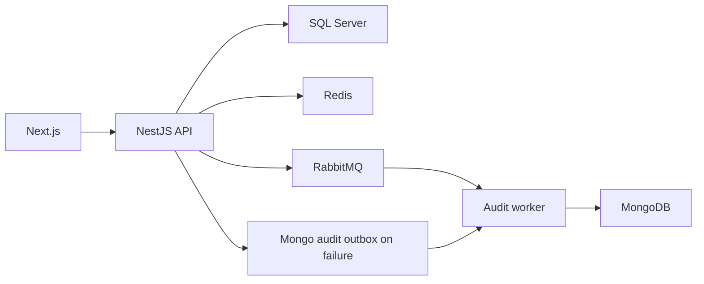

# Project overview

Fleet management for brands, models, vehicles, users, sessions and audit. The frontend browses/manages records according to permissions. SQL Server stores relational domain data, MongoDB stores audit, while Redis/RabbitMQ provide caching, operational controls and messaging.

## Implemented behavior

NestJS 11, TypeScript 5.7, TypeORM 0.3, Mongoose 8, Redis, RabbitMQ and Cockatiel backend; Next.js 16.2.7/React 19.2.4, TanStack Query 5, Redux Toolkit and Zod frontend. Domain modules separate application, domain, infrastructure and interfaces. API and audit-worker have separate entry points. Ports/repositories, UnitOfWork and domain events structure the application; adapters/feature toggles determine actual behavior.



## Workflow and failure cases

1. /api/auth/register creates users; /api/auth/login validates credentials and issues a JWT with session context. /api/auth/me reads the profile; update/profile and update/password mutate it; logout invalidates sessionId. JWT signature is not the only validity check: the session is also verified. The source reference links endpoints and permission decorators.

2. Brand → associated model → vehicle. VehiclesService checks model existence and uniqueness before persistence and uppercases plates. The aggregate stores plate, chassis, renavam, year, modelId, actor and dates. Search filters plate/model/brand with pagination (page 1, limit 20 defaults). Detailed format rules reside in DTOs/value objects, not only the entity.

3. Reads use RepositoryCacheService when repositoryCache is enabled; writes use UnitOfWork and invalidate list/detail caches. They then record audit and publish domain events. SQL commit and external-system delivery are separate steps, not one transaction spanning SQL, Mongo and the broker.

4. AuditService publishes to the broker with auditAsyncWorker enabled. Publication failure queues a Mongo outbox entry; failure there falls back to direct persistence. With the toggle off it persists directly. The relay runs only in audit-worker, recovers abandoned PROCESSING entries and republishes batches with an attempt limit. Monitor terminal states/logs; fallback cannot eliminate failure of every dependency.

## Configuration and deployment

Copy envexample.txt to .env; Compose starts SQL Server/bootstrap, Redis, Mongo, RabbitMQ, API, audit-worker and frontend. Both backend processes are needed for async audit. Use generate:openapi/export:schemas/generate:client with a running API; generate:client references localhost:3000/docs-json. Run backend test/test:e2e/build and frontend test/test:e2e/lint/build with harness dependencies. For stale lists check invalidation/toggle; missing audit, worker/broker/outbox/Mongo; post-login 401, session/Redis/secret. Terraform under infra describes infrastructure; documentation updates do not apply cloud resources.

## Execution commands

```sh
docker compose up --build
# Validation in a separately configured test environment
npm --prefix backend ci
npm --prefix backend run test
npm --prefix backend run build
npm --prefix frontend ci
npm --prefix frontend run build
```

## Related files

- [backend/src/modules/fleet/application/vehicles.service.ts](https://github.com/Vidigal-code/fleetcore-api/blob/a0b587d48f6701f76facddd40828cd47c0c6fbb2/backend/src/modules/fleet/application/vehicles.service.ts)
- [backend/src/modules/auth/interfaces/http/auth.controller.ts](https://github.com/Vidigal-code/fleetcore-api/blob/a0b587d48f6701f76facddd40828cd47c0c6fbb2/backend/src/modules/auth/interfaces/http/auth.controller.ts)
- [backend/src/modules/audit/audit.service.ts](https://github.com/Vidigal-code/fleetcore-api/blob/a0b587d48f6701f76facddd40828cd47c0c6fbb2/backend/src/modules/audit/audit.service.ts)
- [backend/src/modules/audit/relays/audit-outbox-relay.service.ts](https://github.com/Vidigal-code/fleetcore-api/blob/a0b587d48f6701f76facddd40828cd47c0c6fbb2/backend/src/modules/audit/relays/audit-outbox-relay.service.ts)
- [backend/src/shared/features/feature-toggle.service.ts](https://github.com/Vidigal-code/fleetcore-api/blob/a0b587d48f6701f76facddd40828cd47c0c6fbb2/backend/src/shared/features/feature-toggle.service.ts)
- [docker-compose.yml](https://github.com/Vidigal-code/fleetcore-api/blob/a0b587d48f6701f76facddd40828cd47c0c6fbb2/docker-compose.yml)

## Navigation

- [Project guide](?menu=en&lang=en&id=18)
- [Source reference](?menu=en&lang=en&id=19)
