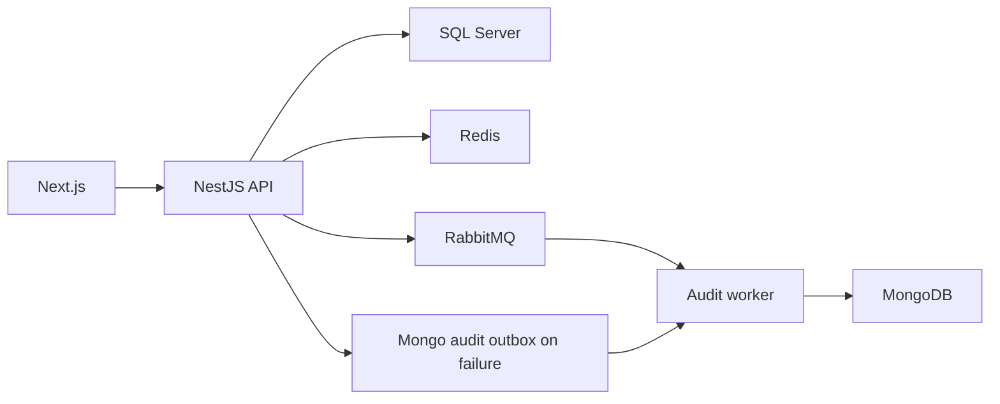

# Arquitectura

Gestión de flota con marcas, modelos, vehículos, usuarios, sesión y auditoría. El frontend consulta/administra según permisos. SQL Server conserva dominio relacional, MongoDB auditoría y Redis/RabbitMQ caché, controles operativos y mensajería.

## Comportamiento implementado

Backend NestJS 11, TypeScript 5.7, TypeORM 0.3, Mongoose 8, Redis, RabbitMQ y Cockatiel; frontend Next.js 16.2.7/React 19.2.4, TanStack Query 5, Redux Toolkit y Zod. Módulos separan application, domain, infrastructure e interfaces. API y audit-worker tienen entradas distintas. Puertos/repositorios, UnitOfWork y eventos estructuran la aplicación; adaptadores/toggles determinan comportamiento.

## Archivos relacionados

- [backend/src/modules/fleet/application/vehicles.service.ts](https://github.com/Vidigal-code/fleetcore-api/blob/a0b587d48f6701f76facddd40828cd47c0c6fbb2/backend/src/modules/fleet/application/vehicles.service.ts)
- [backend/src/modules/auth/interfaces/http/auth.controller.ts](https://github.com/Vidigal-code/fleetcore-api/blob/a0b587d48f6701f76facddd40828cd47c0c6fbb2/backend/src/modules/auth/interfaces/http/auth.controller.ts)
- [backend/src/modules/audit/audit.service.ts](https://github.com/Vidigal-code/fleetcore-api/blob/a0b587d48f6701f76facddd40828cd47c0c6fbb2/backend/src/modules/audit/audit.service.ts)
- [backend/src/modules/audit/relays/audit-outbox-relay.service.ts](https://github.com/Vidigal-code/fleetcore-api/blob/a0b587d48f6701f76facddd40828cd47c0c6fbb2/backend/src/modules/audit/relays/audit-outbox-relay.service.ts)
- [backend/src/shared/features/feature-toggle.service.ts](https://github.com/Vidigal-code/fleetcore-api/blob/a0b587d48f6701f76facddd40828cd47c0c6fbb2/backend/src/shared/features/feature-toggle.service.ts)
- [docker-compose.yml](https://github.com/Vidigal-code/fleetcore-api/blob/a0b587d48f6701f76facddd40828cd47c0c6fbb2/docker-compose.yml)

## Navegación

- [Project guide](?menu=es&lang=es&id=18)
- [Source reference](?menu=es&lang=es&id=19)
