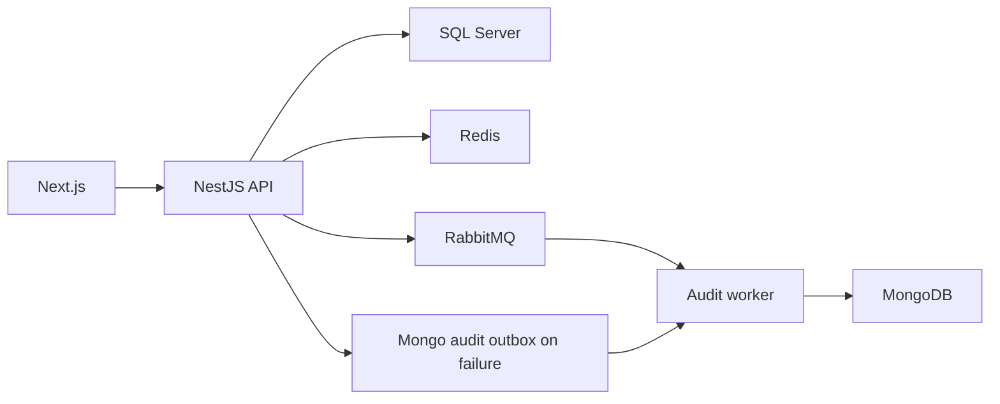

# fleetcore-api: Contexto y flujos del proyecto

GitPageDocs **0.0.17** · 1.0.0 · 2026-10-29

## Contexto

Gestión de flota con marcas, modelos, vehículos, usuarios, sesión y auditoría. El frontend consulta/administra según permisos. SQL Server conserva dominio relacional, MongoDB auditoría y Redis/RabbitMQ caché, controles operativos y mensajería.

## Stack y arquitectura

Backend NestJS 11, TypeScript 5.7, TypeORM 0.3, Mongoose 8, Redis, RabbitMQ y Cockatiel; frontend Next.js 16.2.7/React 19.2.4, TanStack Query 5, Redux Toolkit y Zod. Módulos separan application, domain, infrastructure e interfaces. API y audit-worker tienen entradas distintas. Puertos/repositorios, UnitOfWork y eventos estructuran la aplicación; adaptadores/toggles determinan comportamiento.

## Flujos completos

1. /api/auth/register crea usuarios; /api/auth/login valida credenciales y emite JWT con sesión. /api/auth/me consulta perfil; update/profile y update/password modifican; logout invalida sessionId. La firma JWT no es la única comprobación: también se verifica sesión. La referencia enlaza rutas y permisos.

2. Marca → modelo asociado → vehículo. VehiclesService verifica modelo y unicidad, normalizando matrícula a mayúsculas. El agregado guarda matrícula, chasis, renavam, año, modelId, autor y fechas. Busca filtra matrícula/modelo/marca y pagina (1, límite 20 por defecto). DTOs/value objects contienen validaciones de formato.

3. Lecturas usan RepositoryCacheService con repositoryCache activo; escrituras usan UnitOfWork e invalidan cachés de lista/detalle. Después auditan y publican eventos. Commit SQL y entrega externa son etapas distintas, no una transacción conjunta SQL/Mongo/broker.

4. AuditService publica al broker con auditAsyncWorker activo. Si falla usa outbox Mongo; si también falla intenta escritura directa. Con toggle desactivado escribe directamente. El relay solo ejecuta en audit-worker, recupera PROCESSING abandonadas y republica lotes con límite de intentos. Vigile estados terminales/logs; fallback no evita la caída de todas las dependencias.

## Datos, seguridad y límites

Autenticación, roles, rate limiting, idempotencia, locks y caché tienen módulos propios. Configure controles mediante AppConfig/toggles; instalar Redis no activa todo. Correlacione logs/auditoría por correlationId/requestId cuando existan. Frontend usa OpenAPI/schemas; backend valida y autoriza. Los tipos generados no son fuente principal editable.

## Ejecución, pruebas y operación

Copie envexample.txt a .env; Compose inicia SQL Server/bootstrap, Redis, Mongo, RabbitMQ, API, audit-worker y frontend. Ambos procesos backend son necesarios para auditoría asíncrona. Use generate:openapi/export:schemas/generate:client con API activa; generate:client apunta a localhost:3000/docs-json. Ejecute pruebas/build backend y test/test:e2e/lint/build frontend con dependencias del harness. Lista obsoleta: invalidación/toggle; auditoría ausente: worker/broker/outbox/Mongo; 401: sesión/Redis/secreto. Terraform en infra no se aplica al actualizar documentación.

## Referencia completa

Dependencias, comandos, endpoints, variables, contratos y pruebas están en la [referencia del código](?menu=es&lang=es&id=19).

## Fuentes verificables

- [backend/src/modules/fleet/application/vehicles.service.ts](https://github.com/Vidigal-code/fleetcore-api/blob/a0b587d48f6701f76facddd40828cd47c0c6fbb2/backend/src/modules/fleet/application/vehicles.service.ts)

- [backend/src/modules/auth/interfaces/http/auth.controller.ts](https://github.com/Vidigal-code/fleetcore-api/blob/a0b587d48f6701f76facddd40828cd47c0c6fbb2/backend/src/modules/auth/interfaces/http/auth.controller.ts)

- [backend/src/modules/audit/audit.service.ts](https://github.com/Vidigal-code/fleetcore-api/blob/a0b587d48f6701f76facddd40828cd47c0c6fbb2/backend/src/modules/audit/audit.service.ts)

- [backend/src/modules/audit/relays/audit-outbox-relay.service.ts](https://github.com/Vidigal-code/fleetcore-api/blob/a0b587d48f6701f76facddd40828cd47c0c6fbb2/backend/src/modules/audit/relays/audit-outbox-relay.service.ts)

- [backend/src/shared/features/feature-toggle.service.ts](https://github.com/Vidigal-code/fleetcore-api/blob/a0b587d48f6701f76facddd40828cd47c0c6fbb2/backend/src/shared/features/feature-toggle.service.ts)

- [docker-compose.yml](https://github.com/Vidigal-code/fleetcore-api/blob/a0b587d48f6701f76facddd40828cd47c0c6fbb2/docker-compose.yml)
