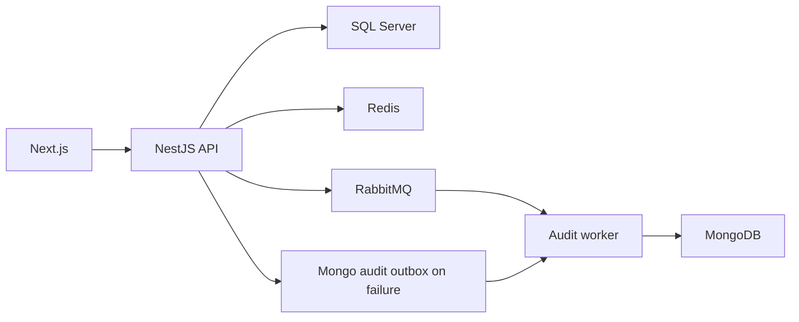

# fleetcore-api: Contexto y flujos del proyecto

GitPageDocs **0.0.24** · 1.0.0 · 2026-11-08

## Contexto

Gestión de flota con marcas, modelos, vehículos, usuarios, sesión y auditoría. El frontend consulta/administra según permisos. SQL Server conserva dominio relacional, MongoDB auditoría y Redis/RabbitMQ caché, controles operativos y mensajería.

## Stack y arquitectura

Backend NestJS 11, TypeScript 5.7, TypeORM 0.3, Mongoose 8, Redis, RabbitMQ y Cockatiel; frontend Next.js 16.2.7/React 19.2.4, TanStack Query 5, Redux Toolkit y Zod. Módulos separan application, domain, infrastructure e interfaces. API y audit-worker tienen entradas distintas. Puertos/repositorios, UnitOfWork y eventos estructuran la aplicación; adaptadores/toggles determinan comportamiento.



## Flujos completos

1. /api/auth/register crea usuarios; /api/auth/login valida credenciales y emite JWT con sesión. /api/auth/me consulta perfil; update/profile y update/password modifican; logout invalida sessionId. La firma JWT no es la única comprobación: también se verifica sesión. La referencia enlaza rutas y permisos.

2. Marca → modelo asociado → vehículo. VehiclesService verifica modelo y unicidad, normalizando matrícula a mayúsculas. El agregado guarda matrícula, chasis, renavam, año, modelId, autor y fechas. Busca filtra matrícula/modelo/marca y pagina (1, límite 20 por defecto). DTOs/value objects contienen validaciones de formato.

3. Lecturas usan RepositoryCacheService con repositoryCache activo; escrituras usan UnitOfWork e invalidan cachés de lista/detalle. Después auditan y publican eventos. Commit SQL y entrega externa son etapas distintas, no una transacción conjunta SQL/Mongo/broker.

4. AuditService publica al broker con auditAsyncWorker activo. Si falla usa outbox Mongo; si también falla intenta escritura directa. Con toggle desactivado escribe directamente. El relay solo ejecuta en audit-worker, recupera PROCESSING abandonadas y republica lotes con límite de intentos. Vigile estados terminales/logs; fallback no evita la caída de todas las dependencias.

## Datos, seguridad y límites

Autenticación, roles, rate limiting, idempotencia, locks y caché tienen módulos propios. Configure controles mediante AppConfig/toggles; instalar Redis no activa todo. Correlacione logs/auditoría por correlationId/requestId cuando existan. Frontend usa OpenAPI/schemas; backend valida y autoriza. Los tipos generados no son fuente principal editable.

## Ejecución, pruebas y operación

Copie envexample.txt a .env; Compose inicia SQL Server/bootstrap, Redis, Mongo, RabbitMQ, API, audit-worker y frontend. Ambos procesos backend son necesarios para auditoría asíncrona. Use generate:openapi/export:schemas/generate:client con API activa; generate:client apunta a localhost:3000/docs-json. Ejecute pruebas/build backend y test/test:e2e/lint/build frontend con dependencias del harness. Lista obsoleta: invalidación/toggle; auditoría ausente: worker/broker/outbox/Mongo; 401: sesión/Redis/secreto. Terraform en infra no se aplica al actualizar documentación.

## Referencia completa

Dependencias, comandos, endpoints, variables, contratos y pruebas están en la [referencia del código](?menu=es&lang=es&id=19).

## Fuentes verificables

- [backend/src/modules/fleet/application/vehicles.service.ts](https://github.com/Vidigal-code/fleetcore-api/blob/a0b587d48f6701f76facddd40828cd47c0c6fbb2/backend/src/modules/fleet/application/vehicles.service.ts)

- [backend/src/modules/auth/interfaces/http/auth.controller.ts](https://github.com/Vidigal-code/fleetcore-api/blob/a0b587d48f6701f76facddd40828cd47c0c6fbb2/backend/src/modules/auth/interfaces/http/auth.controller.ts)

- [backend/src/modules/audit/audit.service.ts](https://github.com/Vidigal-code/fleetcore-api/blob/a0b587d48f6701f76facddd40828cd47c0c6fbb2/backend/src/modules/audit/audit.service.ts)

- [backend/src/modules/audit/relays/audit-outbox-relay.service.ts](https://github.com/Vidigal-code/fleetcore-api/blob/a0b587d48f6701f76facddd40828cd47c0c6fbb2/backend/src/modules/audit/relays/audit-outbox-relay.service.ts)

- [backend/src/shared/features/feature-toggle.service.ts](https://github.com/Vidigal-code/fleetcore-api/blob/a0b587d48f6701f76facddd40828cd47c0c6fbb2/backend/src/shared/features/feature-toggle.service.ts)

- [docker-compose.yml](https://github.com/Vidigal-code/fleetcore-api/blob/a0b587d48f6701f76facddd40828cd47c0c6fbb2/docker-compose.yml)

## Navegación de la documentación con GitPageDocs 0.0.24

Las opciones de esta sección requieren el runtime GitPageDocs **0.0.24**. La versión documental de este proyecto sigue siendo **1.0.0**. Actualizar texto y configuración no actualiza por sí solo el runtime publicado por el workflow.

### Índice por etiquetas

En `gitpagedocs/docs/versions/1.0.0/config.json`, cada elemento de `routes-md` utiliza `RouteguideBrand: true` y `RouteGuideTags: ["h1", "h2", "h3"]`. El índice incluye los tres primeros niveles de encabezados; los demás permanecen en el documento. Los nombres de propiedades distinguen mayúsculas y minúsculas.

```json
{ "RouteguideBrand": true, "RouteGuideTags": ["h1", "h2", "h3"] }
```

Omitir `RouteGuideTags` conserva el comportamiento anterior, de `h1` a `h6`. Una lista vacía (`[]`) elimina las entradas automáticas por etiqueta; los marcadores explícitos configurados en `markdownMarkers.items` todavía pueden formar parte del índice.

Para incluir otros elementos, añada nombres de etiquetas permitidas por el sanitizador, como `"p"`, `"blockquote"`, `"pre"`, `"table"`, `"img"`, `"details"` o `"summary"`. No hay comodines: `"*"`, las etiquetas peligrosas y las entradas inválidas se ignoran con un diagnóstico. Incluir `p`, `li`, `div` o `span` puede generar muchas entradas; seleccione solo las etiquetas útiles para la lectura.

Los rótulos usan título, texto alternativo o texto del elemento. Los elementos vacíos como `br`, `hr`, `img` e `input` pueden usar el nombre de la etiqueta. Los IDs automáticos son estables, únicos y separados por bloque. Utilice `markdownMarkers.items` para elegir una ocurrencia, definir un rótulo propio o aplicar un resaltado específico.

### Desplazamiento, pantallas pequeñas y plegables

Con el desplazamiento del índice desbloqueado, la entrada activa queda centrada, incluso al navegar con Anterior/Siguiente. El candado conserva la posición elegida manualmente en el índice. Esto permite consultar otra parte del índice sin que el seguimiento automático desplace la lista.

Al validar en un móvil, revise el menú contraído, las áreas táctiles, el foco del teclado, las tablas y los bloques de código con desplazamiento horizontal. En dispositivos plegables, repita la navegación con la pantalla plegada y abierta, en ambas orientaciones, y compruebe que la entrada activa siga accesible tras cambiar el ancho. Utilice el control de pausa cuando haya efectos animados y respete la preferencia de movimiento reducido.

GitPageDocs 0.0.24 utiliza `performance.mode: "auto"` para los efectos de los temas: reduce moderadamente la densidad en escritorio y utiliza un presupuesto menor por debajo de 768px, conservando las capas del tema. Las partículas ocultas se pausan y retoman la misma fase al cambiar el ancho. Para mantener la densidad completa, combine `site.backgroundEffects.overrides.performance: { "mode": "full" }` con `gitpagedocs/config.json`; la misma opción está disponible en `site.backgroundEffects.themes[themeId].performance`. Un override explícito de `layers` conserva la cantidad completa cuando no se define mode en los overrides. Seleccione `"auto"` explícitamente para aplicar el presupuesto también a las capas personalizadas.

## Familia de tema fija y modo claro/oscuro

`HideThemeSelector: true` oculta el selector completo de temas y mantiene la familia elegida por `ThemeDefault`. La alternancia claro/oscuro sigue disponible cuando esa familia tiene un par válido. Un tema diferente procedente de la URL o del almacenamiento del navegador no sustituye la familia fija.

`ThemeModeDefault` es el valor inicial de respaldo. Un modo válido en `modetheme=light` o `modetheme=dark` de la URL, un modo guardado o el botón del lector puede seleccionar claro/oscuro dentro de esa familia. El modo elegido se conserva al recargar y navegar entre documentos. En pantallas estrechas, abra Menu para acceder al control estándar. Sin un par válido, el control no aparece.

Las dos entradas del catálogo de layouts deben habilitar `supportsLightAndDarkModes`, compartir el mismo `supportsLightAndDarkModesReference` no vacío y declarar valores opuestos de `mode` (`light` y `dark`). Este proyecto utiliza el catálogo oficial con pares; conserve su familia y preferencias al actualizar los pins del runtime o de los layouts.
