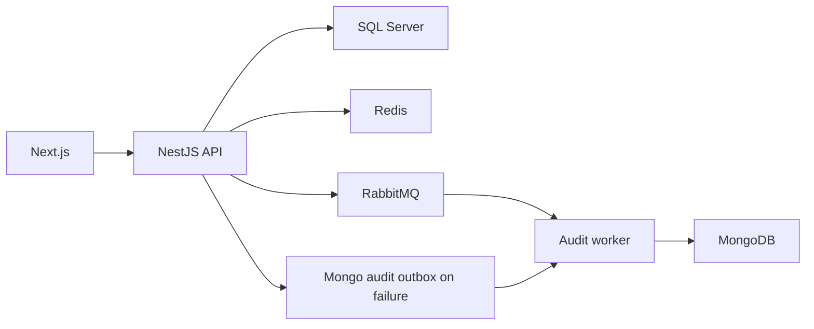

# Introdução ao Desafio

Gestão de frota com marcas, modelos, veículos, usuários, sessão e auditoria. O frontend permite consultar e administrar os registros conforme permissões. SQL Server mantém o domínio relacional; MongoDB mantém auditoria; Redis e RabbitMQ atendem cache, controles operacionais e mensageria.

## Comportamento implementado

NestJS 11, TypeScript 5.7, TypeORM 0.3, Mongoose 8, Redis, RabbitMQ e Cockatiel no backend; Next.js 16.2.7/React 19.2.4, TanStack Query 5, Redux Toolkit e Zod no frontend. Módulos de domínio separam application, domain, infrastructure e interfaces. Existem entradas distintas para API e audit-worker. A arquitetura usa portas/repositórios, UnitOfWork e eventos de domínio; os adaptadores e feature toggles determinam o comportamento efetivo.



## Fluxo e casos de falha

1. /api/auth/register cria usuário; /api/auth/login valida credenciais e emite JWT com contexto de sessão. /api/auth/me consulta perfil; update/profile e update/password modificam dados; logout invalida sessionId. O JWT não é a única fonte de validade: a sessão também é verificada. Endpoints e decorators de permissão estão na referência do código.

2. Marca → modelo vinculado → veículo. VehiclesService valida existência do modelo e unicidade antes de persistir; normaliza placa para maiúsculas. O agregado registra placa, chassi, renavam, ano, modelId e autoria/datas. Busca filtra placa/modelo/marca com paginação (padrão página 1, limite 20). Regras detalhadas de formato estão nos DTOs/value objects, não apenas na entidade.

3. Leitura usa RepositoryCacheService quando repositoryCache está ativo; gravação usa UnitOfWork e invalida caches de lista/detalhe. Depois registra auditoria e publica eventos de domínio. O commit SQL e o envio a sistemas externos são etapas distintas: não descreva o fluxo como uma transação única envolvendo SQL, Mongo e broker.

4. AuditService publica no broker quando auditAsyncWorker está ativo. Se a publicação falha, enfileira outbox no Mongo; se isso também falha, tenta persistência direta. Com o toggle desligado, persiste diretamente. O relay roda somente no audit-worker, recupera entradas PROCESSING abandonadas e republica pendências em lotes com limite de tentativas. Monitore estados terminais e logs; fallback não elimina a possibilidade de falha de todas as dependências.

## Configuração e implantação

Copie envexample.txt para .env; Compose sobe SQL Server/inicializador, Redis, Mongo, RabbitMQ, API, audit-worker e frontend. Suba ambos os processos backend para o fluxo assíncrono. Use scripts generate:openapi/export:schemas/generate:client com API disponível; generate:client referencia docs-json em localhost:3000. Rode backend test/test:e2e/build e frontend test/test:e2e/lint/build conforme dependências do harness. Para lista antiga, confira invalidação/toggle; auditoria ausente, worker/broker/outbox/Mongo; 401 após login, sessão/Redis/segredo. Terraform em infra descreve infraestrutura; a atualização documental não aplica recursos cloud.

## Comandos de execução

```sh
docker compose up --build
# Validation in a separately configured test environment
npm --prefix backend ci
npm --prefix backend run test
npm --prefix backend run build
npm --prefix frontend ci
npm --prefix frontend run build
```

## Arquivos relacionados

- [backend/src/modules/fleet/application/vehicles.service.ts](https://github.com/Vidigal-code/fleetcore-api/blob/a0b587d48f6701f76facddd40828cd47c0c6fbb2/backend/src/modules/fleet/application/vehicles.service.ts)
- [backend/src/modules/auth/interfaces/http/auth.controller.ts](https://github.com/Vidigal-code/fleetcore-api/blob/a0b587d48f6701f76facddd40828cd47c0c6fbb2/backend/src/modules/auth/interfaces/http/auth.controller.ts)
- [backend/src/modules/audit/audit.service.ts](https://github.com/Vidigal-code/fleetcore-api/blob/a0b587d48f6701f76facddd40828cd47c0c6fbb2/backend/src/modules/audit/audit.service.ts)
- [backend/src/modules/audit/relays/audit-outbox-relay.service.ts](https://github.com/Vidigal-code/fleetcore-api/blob/a0b587d48f6701f76facddd40828cd47c0c6fbb2/backend/src/modules/audit/relays/audit-outbox-relay.service.ts)
- [backend/src/shared/features/feature-toggle.service.ts](https://github.com/Vidigal-code/fleetcore-api/blob/a0b587d48f6701f76facddd40828cd47c0c6fbb2/backend/src/shared/features/feature-toggle.service.ts)
- [docker-compose.yml](https://github.com/Vidigal-code/fleetcore-api/blob/a0b587d48f6701f76facddd40828cd47c0c6fbb2/docker-compose.yml)

## Navegação

- [Project guide](?menu=pt&lang=pt&id=18)
- [Source reference](?menu=pt&lang=pt&id=19)
