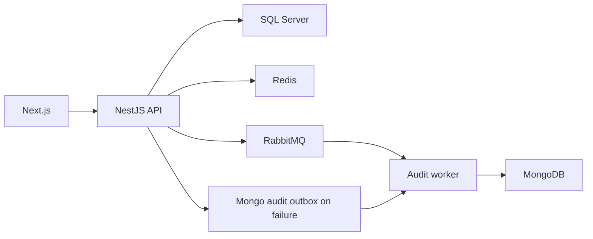

# Arquitetura

Gestão de frota com marcas, modelos, veículos, usuários, sessão e auditoria. O frontend permite consultar e administrar os registros conforme permissões. SQL Server mantém o domínio relacional; MongoDB mantém auditoria; Redis e RabbitMQ atendem cache, controles operacionais e mensageria.

## Comportamento implementado

NestJS 11, TypeScript 5.7, TypeORM 0.3, Mongoose 8, Redis, RabbitMQ e Cockatiel no backend; Next.js 16.2.7/React 19.2.4, TanStack Query 5, Redux Toolkit e Zod no frontend. Módulos de domínio separam application, domain, infrastructure e interfaces. Existem entradas distintas para API e audit-worker. A arquitetura usa portas/repositórios, UnitOfWork e eventos de domínio; os adaptadores e feature toggles determinam o comportamento efetivo.

## Arquivos relacionados

- [backend/src/modules/fleet/application/vehicles.service.ts](https://github.com/Vidigal-code/fleetcore-api/blob/a0b587d48f6701f76facddd40828cd47c0c6fbb2/backend/src/modules/fleet/application/vehicles.service.ts)
- [backend/src/modules/auth/interfaces/http/auth.controller.ts](https://github.com/Vidigal-code/fleetcore-api/blob/a0b587d48f6701f76facddd40828cd47c0c6fbb2/backend/src/modules/auth/interfaces/http/auth.controller.ts)
- [backend/src/modules/audit/audit.service.ts](https://github.com/Vidigal-code/fleetcore-api/blob/a0b587d48f6701f76facddd40828cd47c0c6fbb2/backend/src/modules/audit/audit.service.ts)
- [backend/src/modules/audit/relays/audit-outbox-relay.service.ts](https://github.com/Vidigal-code/fleetcore-api/blob/a0b587d48f6701f76facddd40828cd47c0c6fbb2/backend/src/modules/audit/relays/audit-outbox-relay.service.ts)
- [backend/src/shared/features/feature-toggle.service.ts](https://github.com/Vidigal-code/fleetcore-api/blob/a0b587d48f6701f76facddd40828cd47c0c6fbb2/backend/src/shared/features/feature-toggle.service.ts)
- [docker-compose.yml](https://github.com/Vidigal-code/fleetcore-api/blob/a0b587d48f6701f76facddd40828cd47c0c6fbb2/docker-compose.yml)

## Navegação

- [Project guide](?menu=pt&lang=pt&id=18)
- [Source reference](?menu=pt&lang=pt&id=19)
