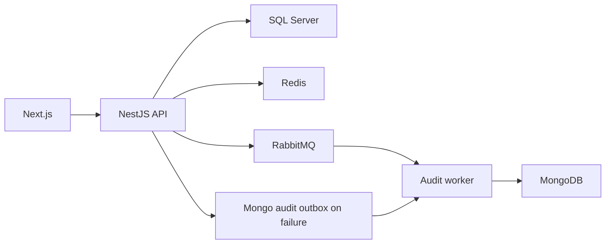

# fleetcore-api: Contexto e fluxos do projeto

GitPageDocs **0.0.26** · 1.0.0 · 2026-11-08

## Contexto

Gestão de frota com marcas, modelos, veículos, usuários, sessão e auditoria. O frontend permite consultar e administrar os registros conforme permissões. SQL Server mantém o domínio relacional; MongoDB mantém auditoria; Redis e RabbitMQ atendem cache, controles operacionais e mensageria.

## Stack e arquitetura

NestJS 11, TypeScript 5.7, TypeORM 0.3, Mongoose 8, Redis, RabbitMQ e Cockatiel no backend; Next.js 16.2.7/React 19.2.4, TanStack Query 5, Redux Toolkit e Zod no frontend. Módulos de domínio separam application, domain, infrastructure e interfaces. Existem entradas distintas para API e audit-worker. A arquitetura usa portas/repositórios, UnitOfWork e eventos de domínio; os adaptadores e feature toggles determinam o comportamento efetivo.



## Fluxos completos

1. /api/auth/register cria usuário; /api/auth/login valida credenciais e emite JWT com contexto de sessão. /api/auth/me consulta perfil; update/profile e update/password modificam dados; logout invalida sessionId. O JWT não é a única fonte de validade: a sessão também é verificada. Endpoints e decorators de permissão estão na referência do código.

2. Marca → modelo vinculado → veículo. VehiclesService valida existência do modelo e unicidade antes de persistir; normaliza placa para maiúsculas. O agregado registra placa, chassi, renavam, ano, modelId e autoria/datas. Busca filtra placa/modelo/marca com paginação (padrão página 1, limite 20). Regras detalhadas de formato estão nos DTOs/value objects, não apenas na entidade.

3. Leitura usa RepositoryCacheService quando repositoryCache está ativo; gravação usa UnitOfWork e invalida caches de lista/detalhe. Depois registra auditoria e publica eventos de domínio. O commit SQL e o envio a sistemas externos são etapas distintas: não descreva o fluxo como uma transação única envolvendo SQL, Mongo e broker.

4. AuditService publica no broker quando auditAsyncWorker está ativo. Se a publicação falha, enfileira outbox no Mongo; se isso também falha, tenta persistência direta. Com o toggle desligado, persiste diretamente. O relay roda somente no audit-worker, recupera entradas PROCESSING abandonadas e republica pendências em lotes com limite de tentativas. Monitore estados terminais e logs; fallback não elimina a possibilidade de falha de todas as dependências.

## Dados, segurança e limites

Autenticação, roles, rate limiting, idempotência, locks e cache têm módulos próprios. Ative e configure controles conforme AppConfig/feature toggles, sem pressupor que instalar Redis habilita tudo. Auditoria e logs devem ser consultados por correlationId/requestId quando presentes. Frontend usa contratos OpenAPI e schemas; o backend aplica validação e autorização. Tipos gerados não devem ser editados como fonte principal.

## Execução, testes e operação

Copie envexample.txt para .env; Compose sobe SQL Server/inicializador, Redis, Mongo, RabbitMQ, API, audit-worker e frontend. Suba ambos os processos backend para o fluxo assíncrono. Use scripts generate:openapi/export:schemas/generate:client com API disponível; generate:client referencia docs-json em localhost:3000. Rode backend test/test:e2e/build e frontend test/test:e2e/lint/build conforme dependências do harness. Para lista antiga, confira invalidação/toggle; auditoria ausente, worker/broker/outbox/Mongo; 401 após login, sessão/Redis/segredo. Terraform em infra descreve infraestrutura; a atualização documental não aplica recursos cloud.

## Referência completa

Dependências, comandos, endpoints, variáveis, contratos e testes estão na [referência do código](?menu=pt&lang=pt&id=19).

## Fontes verificáveis

- [backend/src/modules/fleet/application/vehicles.service.ts](https://github.com/Vidigal-code/fleetcore-api/blob/a0b587d48f6701f76facddd40828cd47c0c6fbb2/backend/src/modules/fleet/application/vehicles.service.ts)

- [backend/src/modules/auth/interfaces/http/auth.controller.ts](https://github.com/Vidigal-code/fleetcore-api/blob/a0b587d48f6701f76facddd40828cd47c0c6fbb2/backend/src/modules/auth/interfaces/http/auth.controller.ts)

- [backend/src/modules/audit/audit.service.ts](https://github.com/Vidigal-code/fleetcore-api/blob/a0b587d48f6701f76facddd40828cd47c0c6fbb2/backend/src/modules/audit/audit.service.ts)

- [backend/src/modules/audit/relays/audit-outbox-relay.service.ts](https://github.com/Vidigal-code/fleetcore-api/blob/a0b587d48f6701f76facddd40828cd47c0c6fbb2/backend/src/modules/audit/relays/audit-outbox-relay.service.ts)

- [backend/src/shared/features/feature-toggle.service.ts](https://github.com/Vidigal-code/fleetcore-api/blob/a0b587d48f6701f76facddd40828cd47c0c6fbb2/backend/src/shared/features/feature-toggle.service.ts)

- [docker-compose.yml](https://github.com/Vidigal-code/fleetcore-api/blob/a0b587d48f6701f76facddd40828cd47c0c6fbb2/docker-compose.yml)

## Navegação da documentação com GitPageDocs 0.0.26

As opções desta seção requerem o runtime GitPageDocs **0.0.26**. A versão documental deste projeto continua **1.0.0**. Atualizar o texto e a configuração não atualiza, por si só, o runtime publicado pelo workflow.

### Índice por tags

Em `gitpagedocs/docs/versions/1.0.0/config.json`, cada item de `routes-md` usa `RouteguideBrand: true` e `RouteGuideTags: ["h1", "h2", "h3"]`. O índice mantém os três primeiros níveis de títulos; os demais títulos continuam no documento. A grafia das propriedades diferencia maiúsculas e minúsculas.

```json
{ "RouteguideBrand": true, "RouteGuideTags": ["h1", "h2", "h3"] }
```

Omitir `RouteGuideTags` preserva o comportamento legado, com `h1` até `h6`. Uma lista vazia (`[]`) remove as entradas automáticas por tag; marcadores explícitos configurados em `markdownMarkers.items` ainda podem compor o índice.

Para incluir outros elementos, acrescente nomes de tags permitidas pelo sanitizador, por exemplo `"p"`, `"blockquote"`, `"pre"`, `"table"`, `"img"`, `"details"` ou `"summary"`. Não existe curinga: `"*"`, tags perigosas e entradas inválidas são ignorados com diagnóstico. Incluir `p`, `li`, `div` ou `span` pode gerar muitas entradas; prefira somente as tags úteis para a leitura.

Os rótulos usam título, texto alternativo ou texto do elemento. Elementos vazios como `br`, `hr`, `img` e `input` podem usar o nome da tag. IDs automáticos são estáveis, únicos e separados por bloco. Use `markdownMarkers.items` quando precisar escolher uma ocorrência, definir rótulo próprio ou aplicar um destaque específico.

### Rolagem, telas pequenas e dobráveis

Com a rolagem do índice desbloqueada, o item ativo é centralizado, inclusive ao navegar por Anterior/Próximo. O cadeado preserva a posição escolhida manualmente no índice. Isso permite consultar outra parte do índice sem que o acompanhamento automático reposicione a lista.

Ao validar em celular, confira o menu recolhido, alvos de toque, foco por teclado, tabelas e blocos de código com rolagem horizontal. Em dispositivos dobráveis, repita a navegação com a tela dobrada e aberta, nas duas orientações, e confirme que o item ativo permanece acessível após a mudança de largura. Use o controle de pausa quando houver efeitos animados e respeite a preferência de movimento reduzido.

O GitPageDocs 0.0.26 usa `performance.mode: "auto"` nos efeitos dos temas: reduz moderadamente a densidade no desktop e usa um orçamento menor abaixo de 768px, mantendo as camadas do tema. Partículas ocultas ficam pausadas e retomam a mesma fase ao mudar a largura. Para manter a densidade completa, mescle `site.backgroundEffects.overrides.performance: { "mode": "full" }` em `gitpagedocs/config.json`; a mesma opção pode ser definida em `site.backgroundEffects.themes[themeId].performance`. Um override explícito de `layers` mantém a contagem completa quando não há mode definido nos overrides. Use `"auto"` explicitamente para aplicar o orçamento também às camadas personalizadas.

## Família de tema fixa e modo claro/escuro

`HideThemeSelector: true` oculta o seletor completo de temas e mantém a família escolhida por `ThemeDefault`. A alternância claro/escuro continua disponível quando essa família possui um par válido. Um tema diferente vindo da URL ou do armazenamento do navegador não substitui a família fixa.

`ThemeModeDefault` é o fallback inicial. Um modo válido em `modetheme=light` ou `modetheme=dark` na URL, um modo salvo ou o botão do leitor pode selecionar claro/escuro dentro dessa família. O modo escolhido permanece após recarregar e navegar entre documentos. Em telas estreitas, abra Menu para acessar o controle padrão. Sem um par válido, o controle não aparece.

As duas entradas do catálogo de layouts devem habilitar `supportsLightAndDarkModes`, compartilhar o mesmo `supportsLightAndDarkModesReference` não vazio e declarar valores opostos de `mode` (`light` e `dark`). Este projeto usa o catálogo oficial com pares; preserve sua família e preferências ao atualizar os pins do runtime ou dos layouts.

## Altura do guia lateral desktop

Em telas desktop com mais de 1024 pixels CSS, o guia lateral termina após o último item, sem se estender até o fim do artigo. Desde a 0.0.25, ele pode crescer até a altura disponível da janela abaixo do cabeçalho antes de precisar de rolagem interna. Esse layout lateral tem prioridade sobre `TocScrollMaxHeightDesktop`; o guia centralizado acima do conteúdo e os layouts de até 1024 pixels mantêm suas regras anteriores de dimensionamento. Uma pequena barra na cor do item ativo acompanha a seção marcada durante a rolagem. O indicador usa o acompanhamento de seções existente, sem animação contínua. No GitPageDocs 0.0.26, os guias laterais ganham mais 0.5rem de espaço abaixo do cabeçalho (8px com a fonte raiz padrão) e mantêm 1rem abaixo do cartão no limite da viewport. Esse ajuste vale somente acima de 1024 pixels CSS; os layouts menores são preservados.
